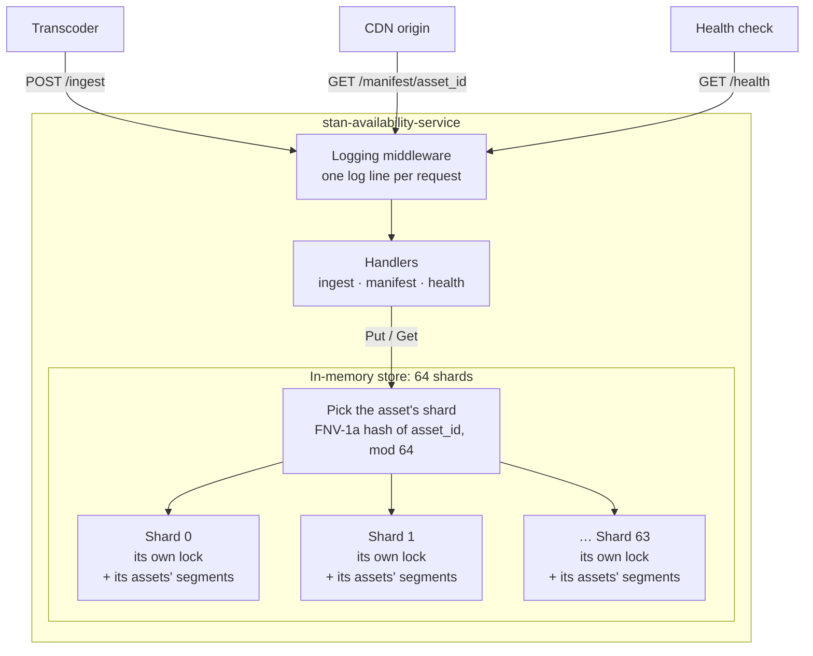
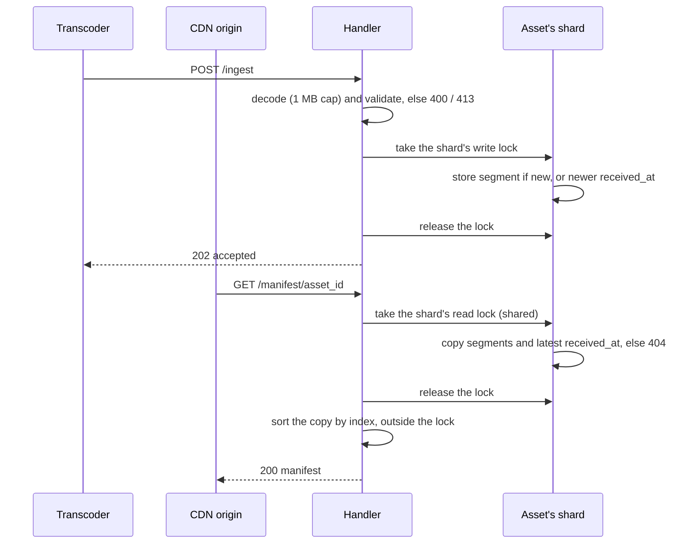

# Streaming Availability Service

Go HTTP service between Stan's transcoder and CDN origins: ingests segment
availability events and serves ordered per-asset manifests.

**Live:** <https://stan-availability-service.onrender.com> (Render free tier, Singapore).
The free tier sleeps after ~15 minutes idle: the first request can take up to a minute, and in-memory state resets on wake or redeploy.

## Getting started

### Prerequisites

- Go 1.27+ (`go version`)
- Optional: Docker, `make`, `curl`, `jq`

No database or external services are needed; state is held in memory.

### Clone

```sh
git clone https://github.com/pjserol/stan-availability-service.git
cd stan-availability-service
```

### Run with Go

```sh
go run ./cmd/server            # or: make run
```

The service listens on `http://localhost:8080`. Override settings with env vars:

```sh
PORT=9000 SHUTDOWN_TIMEOUT=30s go run ./cmd/server
```

| Env var | Default | Purpose |
| --- | --- | --- |
| `PORT` | `8080` | Listen port (set by Render) |
| `SHUTDOWN_TIMEOUT` | `15s` | Drain timeout on SIGTERM (Go duration, e.g. `500ms`, `30s`) |

### Run with Docker

```sh
docker build -t stan-availability-service .
docker run --rm -p 8080:8080 stan-availability-service
```

### Try it

```sh
curl -s localhost:8080/health | jq

curl -s -X POST localhost:8080/ingest \
  -H 'Content-Type: application/json' \
  -d '{"asset_id":"show/thunderbirds/season/1/ep3","segment_index":0,"cdn_url":"https://cdn.example.com/thunderbirds/s1e3/seg0.ts","received_at":"2024-05-01T10:00:00Z"}' | jq

curl -s localhost:8080/manifest/show/thunderbirds/season/1/ep3 | jq
```

### Stop

`Ctrl+C` (SIGINT) or `kill -TERM <pid>` triggers a graceful shutdown: the server stops accepting connections and waits up to `SHUTDOWN_TIMEOUT` for in-flight requests to finish. If the drain times out, remaining connections are closed and the process exits with status 1. A second signal during the drain force-quits.

Keep `SHUTDOWN_TIMEOUT` below the platform's shutdown grace period (about 30s on Render), otherwise the platform kills the process mid-drain.

## Tests

```sh
go test ./...                                  # or: make test
go test -race ./...                            # or: make race
go test -run='^$' -bench=. -benchmem ./...     # or: make bench
```

CI runs `go vet`, `go test` and `go test -race` on every pull request.

**Smoke test** against any running instance, replaying the brief's scenarios 1–6 (unique asset IDs per run, so it is safe against the live service):

```sh
scripts/smoke.sh http://localhost:8080
scripts/smoke.sh https://stan-availability-service.onrender.com
```

**Benchmarks** (Apple M3 Pro):

| Benchmark | Result |
| --- | --- |
| `GET` manifest of 10 / 1,000 / 10,000 segments | ≈0.27 µs / ≈60 µs / ≈0.8 ms, 1 allocation each |
| Parallel `Put` across 1,000 assets, 11 cores | ≈40 ns/op (~25M writes/s) |

## Project layout

```text
cmd/server/       main: config, listener, signal handling, graceful shutdown
internal/config/  PORT and SHUTDOWN_TIMEOUT from the environment
internal/store/   sharded in-memory segment store
internal/api/     HTTP handlers, JSON helpers, request logging middleware
scripts/smoke.sh  end-to-end check against a running instance
```

## Architecture



Each shard maps `asset_id → segment_index → {segment, received_at}`. Requests for different assets usually land on different shards and never wait for each other.



On SIGTERM the server stops accepting connections, drains in-flight requests for up to `SHUTDOWN_TIMEOUT`, then exits.

## API

### `POST /ingest`

Records that a segment is available.

```json
{
  "asset_id": "show/thunderbirds/season/1/ep3",
  "segment_index": 4,
  "cdn_url": "https://cdn.example.com/thunderbirds/s1e3/seg4.ts",
  "received_at": "2024-05-01T10:00:00Z"
}
```

`202 Accepted` → `{"status":"accepted"}`

### `GET /manifest/{asset_id}`

Returns the asset's segments sorted by index. Asset IDs may contain slashes.

```json
{
  "asset_id": "show/thunderbirds/season/1/ep3",
  "segments": [
    { "index": 0, "cdn_url": "https://cdn.example.com/thunderbirds/s1e3/seg0.ts" },
    { "index": 1, "cdn_url": "https://cdn.example.com/thunderbirds/s1e3/seg1.ts" }
  ],
  "last_updated": "2024-05-01T10:00:05Z"
}
```

### `GET /health`

`200 OK` → `{"status":"ok","uptime_seconds":142}`

### Errors

API errors are JSON: `{"error":"<message>"}`. Unknown routes and wrong methods get the router's default plain-text `404` and `405`.

| Status | Message | When |
| --- | --- | --- |
| 400 | `Could not decode request: JSON parsing failed` | Invalid JSON, wrong field type, empty body, trailing data |
| 400 | `missing required field: <name>` | A field is missing, `null` or an empty string |
| 400 | `invalid field: <name>` | Negative `segment_index`, non-http(s) `cdn_url`, non-canonical `asset_id` |
| 404 | `asset not found` | No segment ingested for that asset |
| 413 | `request body too large` | Body over 1 MB |

## Design decision: a sharded store instead of one lock

The main design decision was how to keep the in-memory store safe and fast when many requests arrive at the same time. A single lock for the whole store was ruled out by the brief, and it would also make unrelated assets wait on each other, so I split the store into 64 shards: each asset always maps to the same shard by hashing its ID, and each shard has its own read/write lock. I considered going one step further with a lock per asset, but it adds a second level of locking and extra edge cases for little benefit, because each lock is only held for a very short time. To keep it short, reads copy the segments while holding the lock and sort them after releasing it, so a large manifest never blocks writers. I started with 16 shards, then a parallel benchmark showed contention under load; moving to 64 shards made writes about 1.6× faster, so the final number comes from measurement rather than a guess. A concurrency test with several writers and readers runs under the race detector, and I checked that it fails if a lock is removed. The remaining limit is a single very popular asset, which still sits on one shard; the next step would be to cache the sorted manifest when it changes, so reads become almost free.

Other decisions (duplicate handling by `received_at`, event-time `last_updated` and input validation) are described under Assumptions.

## Assumptions

- **In-memory, single instance.** State is lost on restart, redeploy or free-tier sleep, as the brief allows. No persistence or replication.
- **Duplicates: newest `received_at` wins.** A segment with the same asset and index replaces the stored one only if its `received_at` is strictly newer; equal or older copies are ignored. Retries are therefore idempotent, a late stale retry can't roll back a correction, and the result doesn't depend on arrival order.
- **`last_updated` is the latest `received_at`** among the asset's stored segments (event time, reported in UTC), not the server clock. It is deterministic and survives replays. `received_at` is trusted as set by the transcoder.
- **Gaps are returned as-is.** If segment 3 hasn't arrived yet, the manifest is `[0, 1, 2, 4]`: sorted, but not necessarily contiguous.
- **Validation beyond the required fields**, checked in a fixed order (`asset_id`, `segment_index`, `cdn_url`, `received_at`) so a bad request always gets the same message:
  - unknown JSON fields are ignored, so the transcoder can add fields without breaking ingest;
  - trailing data after the JSON object is a decode error;
  - empty strings count as missing;
  - `segment_index` must be ≥ 0, and `cdn_url` an absolute `http`/`https` URL;
  - `asset_id` must be canonical (no leading or trailing `/`, `//`, `.` or `..` segments): the HTTP router normalises those paths, so such an asset could be stored but never fetched;
  - bodies over 1 MB return 413. Real events are about 200 bytes.
- **The store takes no `context.Context`.** Its operations are in-memory and take microseconds, so there is nothing to cancel. Contexts carry shutdown (signal → drain deadline) and request-scoped logging.
- **`/ingest` is trusted.** It is called by the internal transcoder, so there is no authentication or rate limiting.

## Notes on the spec

Error messages are returned exactly as specified, since clients and tests may match them verbatim. The spec mixes styles (*"Could not decode request: …"* vs *"missing required field: …"* and *"asset not found"*). In a production API I'd standardise on one convention and add a stable machine-readable code, for example RFC 9457 Problem Details with a `type` field, so clients never depend on human-readable text. All errors go through a single `writeError` function, so that change would be made in one place.

## Scenario 7: high-volume burst

*200 goroutines posting segments for 500 assets while 50 goroutines poll random manifests.*

### Where it breaks first

I measured the store: a write takes about 40 ns, and with 64 shards the 500 assets rarely compete for the same lock, so the store should not be the first bottleneck. I haven't load-tested the full HTTP path, so the order below is my expectation; I'd confirm it with a load test of this exact traffic and a CPU profile.

1. **CPU in the HTTP layer** (likely first): parsing requests, JSON decoding and encoding, and the per-request log line cost far more than the store; request logs already show about 0.05–0.25 ms per request against about 40 ns in the store.
2. **Reading long manifests:** every `GET` copies and sorts all segments (about 0.8 ms at 10,000 segments), on every poll.
3. **Memory:** nothing is evicted, so it keeps growing.
4. **One very popular asset:** all its traffic goes to the same shard.

### What I would change

- **Cache the manifest on write.** Rebuild an immutable, sorted snapshot (even pre-encoded JSON) when a segment is actually stored, and publish it through an atomic pointer, so reads stop sorting and locking. Reads vastly outnumber writes, so writes should pay.
- **`ETag` + `If-None-Match` → `304 Not Modified`** from a per-asset version bumped on every write: cheap polls, and correct change detection (unlike `last_updated`).
- **Bound memory:** a TTL or eviction for finished assets, and a cap on segments per asset.
- **Protect the service under overload:** limit concurrent requests and shed load with `503` + `Retry-After` instead of degrading for everyone.
- **Scale out** beyond one instance with state outside the process: a shared store (for example Redis sorted sets keyed by asset), or routing each asset to one instance by consistent hashing. This also fixes losing state on every deploy.
- **Put a CDN or cache in front** of `GET /manifest` with a short TTL, so most polls never reach the service.

### Observability before production

- **RED metrics per route:** request rate, error rate by status and message, and latency histograms (p50/p99).
- **Store metrics:** number of assets and segments, manifest size distribution, and memory/GC from `runtime/metrics`.
- **Contention:** mutex and block profiles (`pprof`) to see whether any shard is hot.
- **Pipeline freshness:** ingest lag (`now − received_at`) and an alert when a live asset's `last_updated` stops moving.
- **Tracing and correlation:** a request ID on every log line and span, plus an instance ID to tell replicas apart.
- **Alerts:** p99 latency, 5xx rate, memory headroom and restarts.

## Known limitations

- **`last_updated` is not a change detector.** It is the newest `received_at`, so a late segment with an older timestamp changes the manifest without advancing it (for example, segment 3 arriving after segment 4). Clients shouldn't skip reprocessing just because `last_updated` is unchanged. Production fix: an `ETag` or per-asset version that changes on every write, with `If-None-Match` → `304 Not Modified` for pollers.
- **In-memory, single instance.** Every restart, redeploy or free-tier sleep starts empty, and there is no replication. A shared store would fix both (see Scenario 7).
- **No eviction.** Memory grows with every asset and segment; finished assets should expire.
- **Gaps are not flagged.** A manifest can be `[0, 1, 2, 4]` while segment 3 is in flight, and a player may stall at the gap. Options: return only the contiguous prefix, or report missing indexes.
- **Reads sort on every request.** Fine for normal assets (≈60 µs at 1,000 segments); a hot or very long asset would benefit from the cached snapshot described in Scenario 7.
- **`/ingest` has no authentication or rate limiting**, on the assumption that only the internal transcoder calls it.
- **Panics are recovered by `net/http`, not by the service.** A panicking handler drops the connection, and its stack trace goes to stderr unstructured. A recovery middleware returning `500` was considered and left out to keep the middleware simple.
- **Limited observability.** One structured log line per request, but no metrics, tracing or request IDs, and logs don't identify the instance.
- **`received_at` is trusted.** A transcoder with a skewed clock would skew `last_updated` and the newest-wins rule.
- **Free-tier hosting.** The first request after ~15 minutes idle can take up to a minute.

## Production readiness: what I'd add next

Beyond scaling (Scenario 7) and the gaps above, these are the engineering practices I'd put in place before running this in production with a team.

### Contract

- **API spec first.** An OpenAPI 3.1 file becomes the source of truth: server interfaces and types generated from it (e.g. `oapi-codegen`), clients generated for the transcoder and CDN teams, docs published from the same file, and CI failing if the code drifts from the contract. Errors move to RFC 9457 Problem Details.

### Delivery

- **Per-environment configuration.** Staging and production values live in the deployment platform (one `render.yaml` or Helm values file per environment), secrets in a secret manager, and a committed `.env.example` documents the variables for local development.
- **A CD pipeline with a promotion gate.** Images tagged by commit SHA deploy to staging first; the end-to-end suite (`scripts/smoke.sh`) runs against it, and only a green run promotes to production. Rollback is a redeploy of the previous image.
- **Supply-chain checks in CI:** `golangci-lint`, `govulncheck`, automated dependency updates and container image scanning.

### Quality

- **Libraries where they pay off.** Standard library only was a constraint of this challenge, not a production goal: well-maintained libraries for configuration, metrics and tracing (OpenTelemetry) save time and bugs.
- **Scheduled load tests** reproducing the Scenario 7 traffic, so performance regressions are caught before release.

### Team and operations

- **AI skills for conventions and onboarding.** Commit agent instructions and skills that encode how this codebase is written (table-driven tests with sentinel errors, logging, API design, PR descriptions), so new developers and AI assistants follow the same patterns from day one.
- **Architecture Decision Records.** The decisions behind this service (sharding, newest-wins duplicates, event-time `last_updated`, drain semantics) recorded next to the code, so the reasoning survives team changes.
- **SLOs, alerts and runbooks.** Targets such as manifest p99 latency and availability, alerts tied to them, and a short on-call runbook.
- **Service-to-service authentication and rate limiting on `/ingest`** (mTLS or signed tokens), instead of assuming an internal caller.
